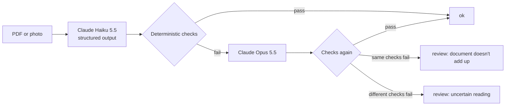

# Invoice Extractor

Extracts structured data from invoices and receipts (PDF or photo) with Claude, checks it with
deterministic rules, and only pays for the strong model when the checks fail. Every design choice
below is backed by an eval on a held-out test set.

## Results

Held-out test split, 46 documents (synthetic invoices, real receipts from CORD and SROIE, FATURA
invoices), never used while tuning prompts or rules:

| Strategy | Docs fully right | False alarms | Printed errors caught | Cost (46 docs) | Latency p50 / p95 |
|---|---|---|---|---|---|
| Haiku only | 87.0% | 1/15 | 2/2 | $0.021 | 2.2 s / 5.0 s |
| Opus only | 93.5% | 1/15 | 2/2 | $0.76 | 3.7 s / 5.3 s |
| **Routed** (Haiku → checks → Opus) | **89.1%** | **0/15** | **2/2** | **$0.28** (36% of Opus) | 4.3 s / 7.1 s |

What the numbers say, including what they don't:

- **Routing buys most of Opus's reliability at a third of the cost**, with no false alarms on clean
  invoices and every deliberately wrong invoice sent to review.
- **Routing only catches errors that break the arithmetic.** The gap to Opus is two documents: one
  silent misread by Haiku that no check contradicts, one Opus run-to-run variance.
- **Routing is only as good as validation precision.** A rule that doesn't fit a document type
  escalates everything: treating foreign tax ids as "invalid" instead of "not checkable" sent 90% of
  Malaysian receipts to Opus; fixing it halved the routed cost on that set.
- **FATURA invoices don't add up on the page** (lines − discount ≠ total, no tax), so validation
  rightly flags all of them and they account for most escalations.
- Small samples: one document is 2–3 points. Treat differences under ~5 points as noise.

## How it works



- **Extraction**: one call with a Zod schema as structured output. The prompt asks the model to
  copy numbers as printed and never fix arithmetic, otherwise the checks would have nothing to catch.
- **Checks** (`src/lib/validate.ts`, no LLM): line math with discounts, lines sum to subtotal,
  subtotal − discount + tax + rounding = total (tax-inclusive receipts supported), Italian VAT
  checksum, Spanish DNI/NIE check letter, plausible date.
- **Review reason**: if Opus fails the same checks as Haiku, the error is on the document itself;
  otherwise the reading is uncertain. A reviewer handles the two very differently.

## Eval

- **Golden set**: documents with known answers.
  - 50 synthetic Italian/Spanish invoices from a seeded generator (exact ground truth by
    construction): 7 with a printed error that must go to review, 20 hard variants (multi-rate
    VAT, line discounts, two pages, photos rotated 90°, low-res photos).
  - 29 real receipts from [CORD v2](https://huggingface.co/datasets/naver-clova-ix/cord-v2)
    (CC BY 4.0), scored on total and lines.
  - 30 invoices from [FATURA](https://huggingface.co/datasets/mathieu1256/FATURA2-invoices)
    (CC BY 4.0), scored on total, currency, date, invoice number.
  - 30 receipts from SROIE (ICDAR 2019), research-only licence: downloaded locally, never committed.
- **Scoring**: exact match per field (amounts to the cent, text ignoring case and punctuation),
  no LLM judge. Plus false alarms on clean invoices, printed errors caught, cost and latency.
- **Split**: dev for tuning, test only for the numbers above.
- Runs are versioned in `eval/runs/`.

```bash
bun run eval --strategy haiku|opus|routed --split dev|test|all [--source syn|cord|fat|sroie]
```

## Stack

Next.js 16 (App Router), TypeScript, Claude API (`@anthropic-ai/sdk`, structured outputs), Zod,
bun, Vercel (Frankfurt). CI on GitHub Actions; static analysis with SonarQube.

## Run locally

```bash
bun install
echo "ANTHROPIC_API_KEY=..." > .env.local
bun dev
curl -F file=@invoice.pdf localhost:3000/api/extract
bun test
```
